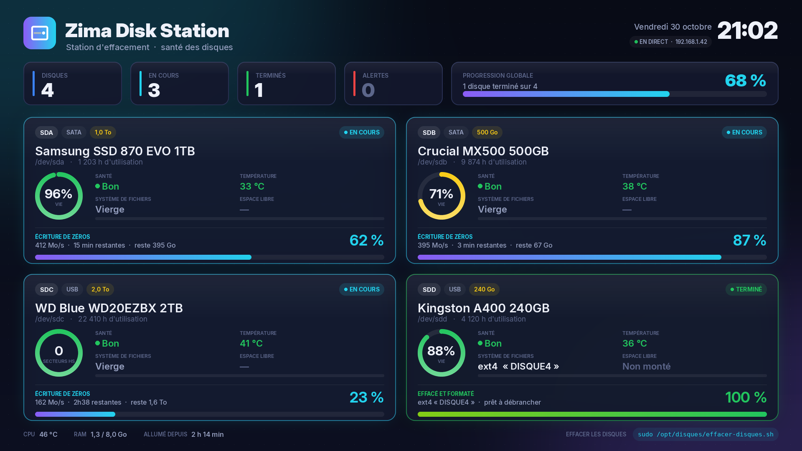
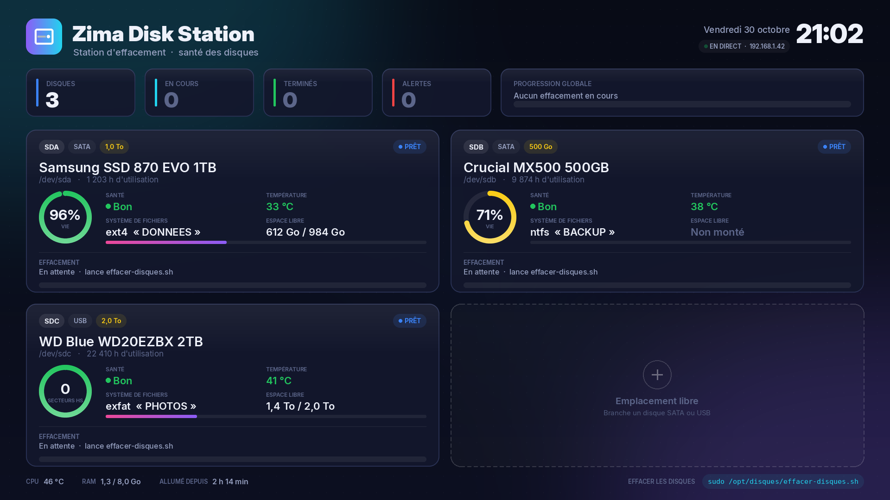
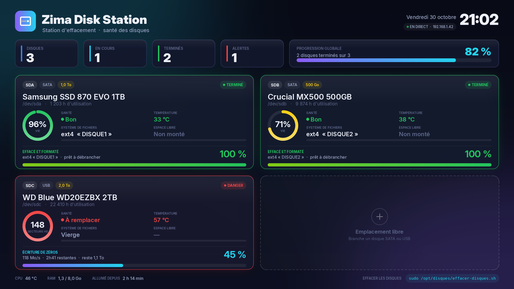
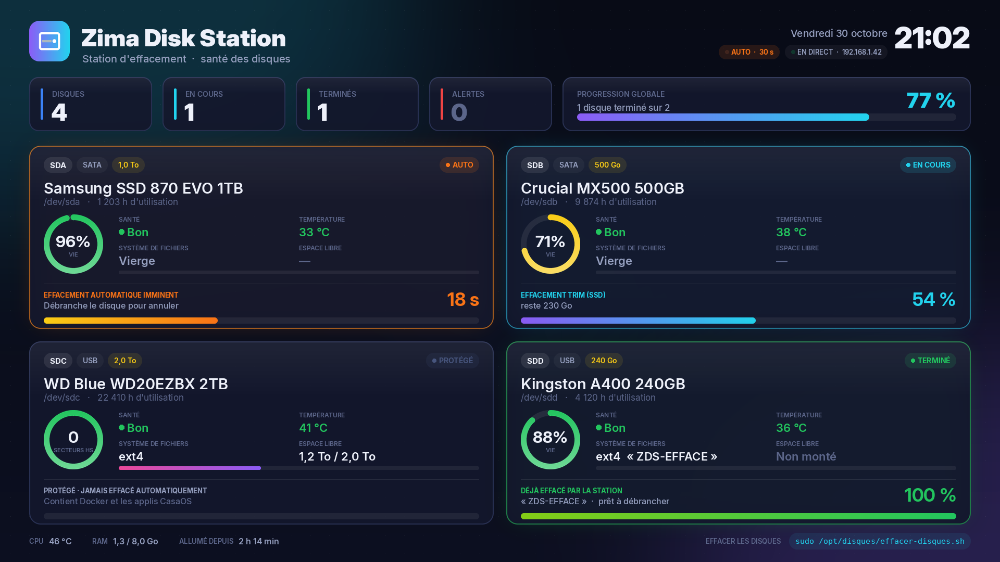

<h1 align="center">💽 Zima Disk Station</h1>

<p align="center">
  Une station d'effacement de disques pour <b>ZimaBoard</b>, avec un tableau de bord plein écran sur la sortie HDMI.<br>
  Santé SMART · % de vie · température · stockage · progression de l'effacement en direct.
</p>

<p align="center">
  
</p>

---

## ✨ Ce que fait la station

| | |
|---|---|
| 🩺 **Santé des disques** | Anneau de vie (vert → jaune → rouge), état SMART, température, heures d'utilisation. Pour les disques durs, nombre de secteurs défectueux. |
| 💾 **Stockage** | Système de fichiers, nom du volume, espace libre / utilisé. |
| 🧹 **Effacement** | Tous les disques SATA, USB et NVMe en même temps, avec %, vitesse, temps restant et Go à effacer. |
| ⚡ **Automatique** | Branche un disque : compte à rebours de 30 s à l'écran, puis effacement. Débranche pour annuler. |
| 🛡️ **Protections** | Ne touche jamais la mémoire interne (eMMC), le disque système ni le disque qui contient Docker / les applis CasaOS. |
| 🖥️ **Écran HDMI** | S'affiche tout seul au démarrage, sans clavier ni souris. |

<p align="center">
  
  &nbsp;
  
</p>

---

## 🚀 Installation (une seule fois)

Dans le terminal du ZimaBoard :

```bash
sudo apt-get install -y -t bullseye git
```
```bash
cd /DATA && sudo git clone https://github.com/gohanian450/zima-disk-station.git
```
```bash
cd /DATA/zima-disk-station && sudo chmod +x *.sh *.py && sudo ./installer.sh
```

> Sur ZimaOS (sans Python), l'installateur construit automatiquement un petit conteneur Docker.

## 🔄 Mettre à jour

```bash
sudo /DATA/zima-disk-station/mettre-a-jour.sh
```

Récupère la dernière version sur GitHub, redémarre l'écran et affiche une vérification ✅ / ❌.

## ✅ Vérifier que tout est en ordre

```bash
sudo /DATA/zima-disk-station/verifier.sh
```

Contrôle la version, les fichiers installés, le démarrage automatique, l'écran détecté et les outils.

---

## ⚡ Effacement automatique (activé par défaut)

Branche un disque : un **compte à rebours de 30 s** s'affiche en orange sur sa carte, puis il est effacé et formaté tout seul.
**Débranche-le pendant le compte à rebours pour annuler.**

<p align="center">
  
</p>

Jamais effacés automatiquement : la mémoire interne, le disque système, le disque qui contient Docker (applis CasaOS)
— affichés « PROTÉGÉ » — et les disques déjà effacés par la station (étiquette `ZDS-EFFACE`).

| Commande | Effet |
|---|---|
| `sudo /opt/disques/auto-effacement.sh --desactiver` | Coupe l'effacement automatique (les disques restent « En attente ») |
| `sudo /opt/disques/auto-effacement.sh --activer` | Le réactive |
| `sudo /opt/disques/auto-effacement.sh --etat` | Affiche le réglage actuel |

Réglages (délai, mode, système de fichiers) : `/etc/zima-disk-station.conf`.

## 🧹 Effacer les disques à la main

| Commande | Effet |
|---|---|
| `sudo /opt/disques/effacer-disques.sh --liste` | Montre ce qui **serait** effacé — rien n'est touché |
| `sudo /opt/disques/effacer-disques.sh` | Effacement rapide (TRIM) + formatage **ext4** |
| `sudo MODE=complet /opt/disques/effacer-disques.sh` | Réécrit tout le disque avec des zéros — lent, % réel, irrécupérable |
| `sudo FS=exfat /opt/disques/effacer-disques.sh` | Formate en **exFAT** (lisible Windows / Mac) |

Le script demande de taper `EFFACER` avant de commencer.

> ⚠️ **L'effacement est définitif.** Lance toujours `--liste` d'abord.
> Sur ZimaOS, le dossier est `/DATA/disques` au lieu de `/opt/disques` (l'installateur l'indique à la fin).

---

## 🧪 Tester l'écran sans disque

```bash
sudo systemctl stop disques-ecran
sudo python3 /opt/disques/ecran-disques.py --demo 2     # 1 = santé · 2 = effacement · 3 = terminé + alerte · 4 = automatique · 0 = vide
sudo systemctl start disques-ecran
```

Ou enregistrer une image : `python3 ecran-disques.py --demo 2 --png apercu.png`

## 🗑️ Désinstaller

```bash
sudo /DATA/zima-disk-station/installer.sh --desinstaller
```

---

## 📁 Contenu

```
installer.sh         installe le service (ou le conteneur Docker) qui affiche l'écran
ecran-disques.py     tableau de bord graphique dessiné sur /dev/fb0
effacer-disques.sh   effacement + formatage, avec progression publiée dans /run/effacement
mettre-a-jour.sh     git pull + réinstallation + vérification
verifier.sh          liste de contrôle ✅ / ❌
auto-effacement.sh   service d'effacement automatique (compte à rebours, protections)
Dockerfile           image utilisée sur ZimaOS
polices/             Inter (SIL Open Font License) et DejaVu Sans Mono
```

Polices : [Inter](https://rsms.me/inter/) par Rasmus Andersson, sous licence SIL OFL 1.1 — voir `polices/LICENCE-Inter.txt`. DejaVu Sans Mono : licence Bitstream Vera / DejaVu — voir `polices/LICENCE-DejaVu.txt`.
